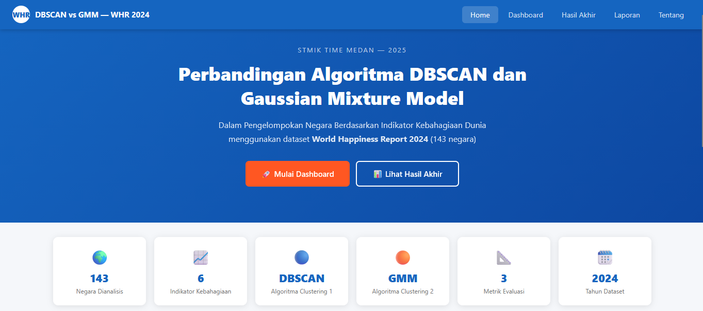
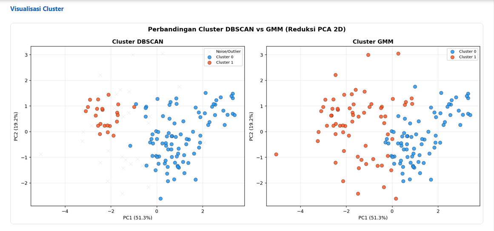

# Clustering Indikator Kebahagiaan Dunia DBSCAN VS GMM
## Tujuan
Membandingkan DBSCAN dan Gaussian Mixture Model (GMM) dalam mengelompokkan 140 negara berdasarkan 6 indikator World Happiness Report 2024 dan menemukan negara anomali (negara anomali merupakan negara yang kondisi ekonomi atau indikatornya tidak sejalan dengan tingkat kebahagiaannya, misalnya: "Kaya tapi Sedih", "Miskin tapi Dermawan", "Korupsi Tinggi tapi Bahagia").

## Dataset
World Happiness Report 2024 (Kaggle): 143 baris, 140 negara dipakai
(3 baris dibuang karena data kosong), 6 indikator (Di Kaggle, setiap indikator ada bagian "Explained by:" yang saya hapus agar data lebih sederhana diproses).
6 indikator yang dipakai: Log GDP per capita, Social support, Healthy life expectancy, Freedom to make life choices, Generosity, Perceptions of corruption. Ladder Score tidak dipakai untuk clustering, hanya untuk menentukan anomali.
Sumber: https://www.kaggle.com/datasets/ajaypalsinghlo/world-happiness-report-2024

## Metode
- Python (Pandas, Scikit-Learn, Numpy, Matplotlib) untuk membuat sebuah program machine learning / prototype sebelum membuat web dashboard interaktif.
- Baris dengan data kosong dibuang (3 baris), fitur distandardisasi dengan StandardScaler.
- PCA 2D untuk visualisasi penyebaran titik data
- DBSCAN: parameter Epsilon = 1,3 dan Minimum Points (MinPts) = 6 dipilih dengan grid search (kriteria Silhouette tertinggi) pada eps (0,5 - 2) dan MinPts (2 - 10)
- GMM: jumlah komponen dipilih dengan BIC (n = 2) dan tipe kovarians = full (default)
- Evaluasi: Silhouette Score (lebih tinggi), Davies-Bouldin (lebih rendah), Calinski-Harabasz (lebih tinggi)
- Dashboard web interaktif dengan framework Flask

## Hasil
|          Metrik         | DBSCAN |  GMM   |
|-------------------------|--------|--------|
|    Silhouette Score     | 0,3968 | 0,2911 |
|   Davies-Bouldin Index  | 0,8246 | 1,3447 |
| Calinski-Harabasz Index |  66,21 |  67,37 |

Anomali: 
- Kaya tapi Sedih (4 negara, Skor Ladder antara 4,975 - 5,785)
Negara: Russia, Hong Kong, Turkiye dan Bulgaria.
- Miskin tapi Senang (2 negara, Skor Ladder antara 5,968 - 6,284)
Negara: Nicaragua dan Honduras.
- Kaya tapi Pelit (17 negara, Skor Ladder antara 4,975 - 6,818)
Contoh: Lithuania, Uruguay, France, Saudi Arabia, Taiwan, Romania, Poland, Chile, Panama dan Italy (10 dari 17).
- Miskin tapi Dermawan (6 negara, Skor Ladder antara 3,861 - 5,714)
Negara: Kyrgyzstan, Gambia, Chad, Kenya, Myanmar, dan Ethiopia.
- Bersih tapi Tidak Bahagia (1 negara, Skor Ladder 5,316)
Negara: Hong Kong.
- Korupsi Tinggi tapi Bahagia (31 negara, Skor Ladder antara 5,816 - 6,955)
Contoh: Costa Rica, Czechia, Mexico, Malaysia, Thailand, Hungary, dan Portugal (7 dari 31).

Halaman Dashboard:

Visualisasi PCA 2D DBSCAN dan Gaussian Mixture Model:


## Cara menjalankan (Seaborn hanya untuk Notebook)
```bash
pip install flask matplotlib pandas numpy seaborn scikit-learn
python app.py
```
Buka http://127.0.0.1:5000/ di browser

## Catatan
- Skor DBSCAN dihitung tanpa noise 29 negara dari 140 negara, sedangkan GMM memakai seluruh data, sehingga perbandingan tidak sepenuhnya setara.
- Kategori GDP, korupsi, dan kedermawanan ditentukan dengan GMM univariat per variabel. Anomali 
"Kaya tapi Sedih", "Miskin tapi Senang", "Korupsi Tinggi tapi Bahagia", dan "Bersih tapi Tidak Bahagia" ditentukan dengan membandingkan kategori tersebut dengan median Ladder score (5,8). "Kaya tapi Pelit" dan "Miskin tapi Dermawan" ditentukan dari kombinasi kategori GDP dan kategori Generosity

